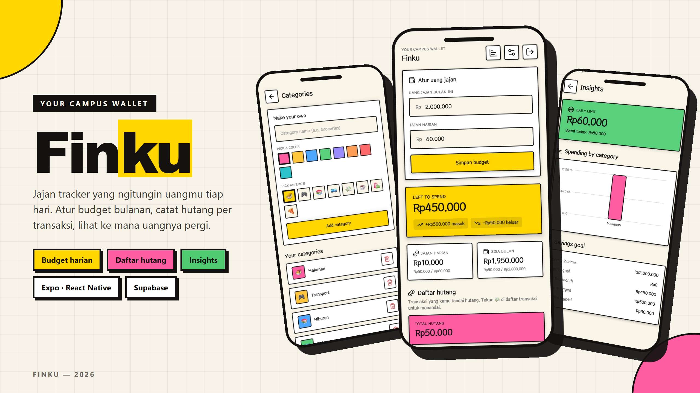

<div align="center">


<br />


# Finku

**Jajan tracker yang ngitungin uangmu tiap hari.**

Set your monthly allowance and daily limit, log what you spend, and see exactly how much you can still use today.


<br />

### [⬇ Download APK](https://github.com/RizkyPutraIchfiandra/finku/releases/latest/download/finku-1.0.0.apk)

Android 7+, 108 MB. Nggak butuh Expo Go.

</div>

---

## What you can do

- **Know your daily number:** set *uang jajan bulan ini* and *jajan harian*, and Finku works out what is still safe to spend today.
- **Log money in seconds:** amount, description, category. Expense or income, with thousand separators typed for you.
- **Read your history by day:** transactions group under each date with its own net total, so you can see which day blew the budget.
- **Mark what you owe:** flag any transaction as *hutang* and it rolls into a running debt total, separate from regular spending.
- **Make categories yours:** name, colour, and emoji, used everywhere from the add screen to the insights chart.
- **Narrow it down:** filter the history by category, by day, or both at once.
- **See the shape of your spending:** a bar chart of your biggest categories plus a savings-goal summary.
- **Top up mid-month:** logging income raises the monthly allowance, so transfers and side-job money are accounted for.

## Built with

| Technology | What it does here |
| --- | --- |
| [Expo](https://expo.dev) SDK 54 | React Native app framework, native builds, and over-the-air updates. |
| [Expo Router](https://docs.expo.dev/router/introduction/) | File-based navigation with typed routes and route groups for auth vs app. |
| [React Native](https://reactnative.dev) 0.81 + [TypeScript](https://www.typescriptlang.org) 5 | Build the interface and keep app code typed end to end. |
| [Supabase](https://supabase.com) | PostgreSQL database, email auth, and Row Level Security so each user only sees their own rows. |
| [NativeWind](https://www.nativewind.dev) + [Tailwind CSS](https://tailwindcss.com) 4 | Utility styling shared across native and web, with the neo-brutalist design tokens. |
| [TanStack Query](https://tanstack.com/query) | Server state, cache invalidation, and offline persistence of the last known data. |
| [react-native-svg](https://github.com/software-mansion/react-native-svg) | Draws the category bar chart on the insights screen. |
| [lucide-react-native](https://lucide.dev) | Icon set, wired into NativeWind through `cssInterop`. |
| [EAS Build & Update](https://docs.expo.dev/eas/) | Produces the standalone Android APK and ships code-only changes without a reinstall. |

## Screens



| Beranda | Add transaction | Categories | Insights |
| --- | --- | --- | --- |
| Budget panel, daily and monthly cards, history grouped by day | Expense or income, amount, description, category | Create and delete your own categories | Daily limit, category chart, savings goal |

## Getting started

### Prerequisites

- Node.js 20 or newer
- A free [Supabase](https://supabase.com) project
- [Expo Go](https://expo.dev/go) for quick runs, or an Android device for the APK

### 1. Install

```bash
git clone https://github.com/<your-username>/finku.git
cd finku/mobile
npm install
```

### 2. Set up the database

In your Supabase project, open **SQL Editor** and run the combined setup script:

```
supabase/_combined_cloud_setup.sql
```

It creates all four tables, indexes, and the Row Level Security policies. If you prefer migrations one at a time, run the files in `supabase/migrations/` in filename order instead.

Then turn **off** email confirmation under **Authentication → Sign In / Providers → User Signups**, so new accounts can log in right away.

### 3. Add your keys

```bash
cp .env.example .env
```

Fill in the two values from **Settings → API** in your Supabase dashboard:

```env
EXPO_PUBLIC_SUPABASE_URL=https://your-project-ref.supabase.co
EXPO_PUBLIC_SUPABASE_ANON_KEY=your-anon-key
```

The anon key is meant to be public. Every table is protected by Row Level Security, so a user can only read and write their own rows. Never put the `service_role` key in this file.

### 4. Run it

```bash
npx expo start
```

Press `a` for Android, `i` for iOS, or `w` for web.

### 5. Build an APK

```bash
npx eas-cli@latest build --platform android --profile preview
```

Code-only changes afterwards ship over the air, no reinstall needed:

```bash
npx eas-cli@latest update --branch preview --message "your change" --environment preview
```

Native changes — app icon, name, package, new native modules — still need a fresh build.

## Data model

Four tables, all keyed to `auth.uid()` through Row Level Security.

```
categories                transactions
├─ id            text pk  ├─ id           text pk
├─ user_id       uuid     ├─ user_id      uuid
├─ name          text     ├─ category_id  text → categories.id (set null)
├─ color         text     ├─ amount       numeric(12,2)
├─ emoji         text     ├─ description  text
└─ created_at    tstz     ├─ type         'income' | 'expense'
                          ├─ is_debt      boolean
budgets                   ├─ spent_at     tstz
├─ id            text pk  └─ created_at   tstz
├─ user_id       uuid
├─ category_id   text     savings_goals
├─ name          text     ├─ id              uuid pk → auth.users.id
├─ monthly_limit numeric  ├─ monthly_income  numeric   (uang jajan bulan ini)
└─ created_at    tstz     ├─ daily_limit     numeric   (jajan harian)
                          ├─ monthly_goal    numeric
                          ├─ created_at      tstz
                          └─ updated_at      tstz
```

Debt lives on the transaction, not the category, so one food purchase can be a debt while the rest are not.

### How the numbers are worked out

| Card | Formula |
| --- | --- |
| Left to spend | total income − total expense |
| Jajan harian | `daily_limit` − expenses dated today |
| Sisa bulan ini | (`monthly_income` + income this month) − expenses this month |
| Total hutang | sum of transactions where `is_debt` is true |

Transaction queries are capped at the 50 most recent rows, so every total above is based on that window rather than the full history.

## Project structure

```
.
├── mobile/                      Expo app
│   ├── app/
│   │   ├── _layout.tsx          Providers: query client, theme, auth
│   │   ├── (auth)/              login, signup
│   │   └── (app)/               index (beranda), add, categories, insights
│   ├── src/
│   │   ├── db/                  Supabase client and generated types
│   │   ├── hooks/               useAuth, useApp, useTheme, useOffline
│   │   └── lib/                 currency format, date helpers, query client
│   ├── assets/                  icons, splash, favicon
│   ├── app.json                 Expo config: name, icons, updates, runtime version
│   └── eas.json                 Build profiles (all APK)
├── supabase/
│   ├── migrations/              Schema history, source of truth
│   └── _combined_cloud_setup.sql  Everything in one paste-able script
└── docs/
    └── FEATURES.md              Feature reference with accessibility labels
```

## Testing

Every interactive element carries an `accessibilityLabel`, which surfaces as `content-desc` on Android and `aria-label` on web. That makes the app drivable by Appium, Maestro, or Playwright without adding test IDs.

[`docs/FEATURES.md`](docs/FEATURES.md) lists every feature with its labels, validation messages, and a happy-path walkthrough.

```bash
cd mobile
npx tsc --noEmit                              # types
npx eslint app src components --ext .ts,.tsx   # lint
```

## Scripts

| Command | What it does |
| --- | --- |
| `npx expo start` | Start the dev server |
| `npx expo export -p web` | Static web build |
| `npx tsc --noEmit` | Type check |
| `npx eslint app src components --ext .ts,.tsx` | Lint |
| `npx eas-cli@latest build -p android --profile preview` | Build an APK |
| `npx eas-cli@latest update --branch preview` | Ship an OTA update |

## License

[MIT](LICENSE)
