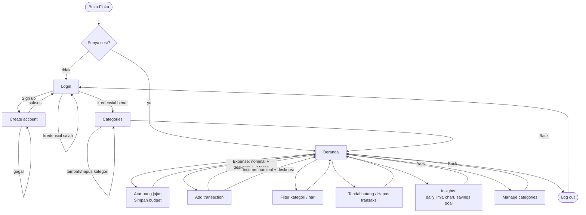
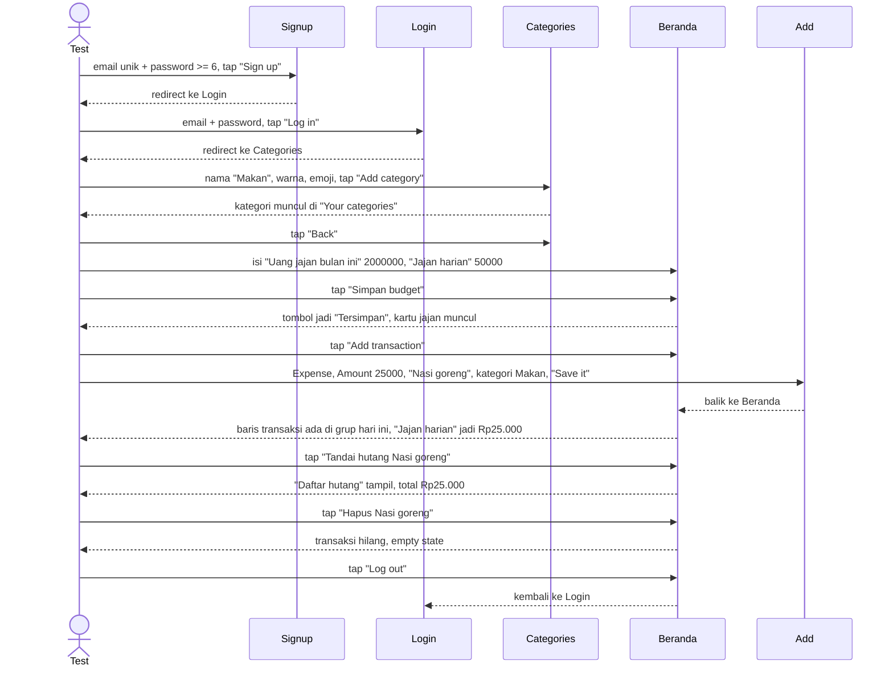

# Finku — Daftar Fitur (untuk Automation Testing)

Backend: Supabase cloud (`obbtqydsxiyviphniwbf`). Tabel: `categories`, `budgets`, `transactions`, `savings_goals`. RLS per user.
Selector automation: pakai **accessibilityLabel** (Android: `content-desc`, web: `aria-label`). Semua tombol/input penting sudah punya label.

## 1. Auth

### 1.1 Sign up — `app/(auth)/signup.tsx` → route `/(auth)/signup`
Bikin akun baru. Setelah sukses sesi langsung di-`signOut`, user dilempar ke `/login` (bukan auto-login).

| Elemen | Label |
|---|---|
| Input email | `Email` |
| Input password | `Password` |
| Tombol daftar | `Sign up` |
| Link ke login | `Log in` |

Validasi (client, sebelum request):
- email/password kosong → `Enter both your email and password.`
- password < 6 char → `Password needs at least 6 characters.`
- error server (mis. email sudah dipakai) → pesan dari Supabase tampil di teks merah.

### 1.2 Login — `app/(auth)/login.tsx` → `/(auth)/login`
| Elemen | Label |
|---|---|
| Input email | `Email` |
| Input password | `Password` |
| Tombol login | `Log in` |
| Link ke signup | `Sign up` |

Sukses → redirect ke **Categories**. Kosong → `Enter both your email and password.`. Kredensial salah → `Invalid login credentials`.

### 1.3 Guard
Buka `/` atau `/insights` tanpa login → layar `Log in to track your money 💸` / `Log in to see insights 📊` + tombol `Login / Sign up`.

### 1.4 Logout
Tombol di header Beranda, label `Log out`. Sesi dihapus, balik ke login.

## 2. Beranda / Dashboard — `app/(app)/index.tsx` → `/`

### 2.1 Atur uang jajan (budget panel)
Simpan ke `savings_goals` (upsert by user id).

| Elemen | Label |
|---|---|
| Input bulanan | `Uang jajan bulan ini` |
| Input harian | `Jajan harian` |
| Tombol simpan | `Simpan budget` |

Perilaku: input auto-format ribuan (`1500000` → `1.500.000`, hanya digit diterima). Sukses → tombol berubah jadi `Tersimpan` selama 2 detik, lalu balik. Kartu `Jajan harian` + `Sisa bulan ini` baru muncul kalau salah satu nilai > 0.

### 2.2 Kartu Left to spend
Saldo = total income − total expense dari 50 transaksi terbaru. Chip `+Rp… masuk` dan `-Rp… keluar`.

### 2.3 Kartu Jajan harian
`jajan harian − pengeluaran hari ini`. Minus → teks merah. Subteks: `terpakai / limit`.

### 2.4 Kartu Sisa bulan ini
`uang jajan bulan ini − pengeluaran sejak tanggal 1`. Minus → merah.

### 2.5 Daftar hutang
Muncul hanya kalau ada transaksi ber-flag `is_debt`. Menampilkan total hutang + daftar item (emoji kategori, deskripsi, tanggal, nominal).

### 2.6 Budget alert
Untuk tiap row `budgets` dengan `monthly_limit > 0` dan pengeluaran kategori ≥ limit → banner `Heads up, you're over budget`.

### 2.7 Recent transactions
Transaksi dikelompokkan **per hari**, hari terbaru di atas. Header grup = tanggal + nama hari, plus net harian (`+`/`-`, merah kalau minus).

Tiap baris punya 2 aksi:

| Aksi | Label | Efek |
|---|---|---|
| Toggle hutang | `Tandai hutang {deskripsi}` / `Hapus hutang {deskripsi}` | update `transactions.is_debt`, ikon `💸` ⇄ `✓` |
| Hapus | `Hapus {deskripsi}` | delete row, list refresh |

### 2.8 Filter kategori
Chip horizontal: `Semua kategori` + `Filter {nama kategori}` per kategori. Chip aktif = background kuning. Tekan chip aktif lagi = reset.

### 2.9 Filter hari
Chip horizontal: `Semua hari` + `Filter {label hari}` untuk setiap hari yang punya transaksi. Bisa dikombinasikan dengan filter kategori.

### 2.10 Empty state
- belum ada transaksi → `No transactions yet`
- ada transaksi tapi filter kosong → `Belum ada transaksi`

### 2.11 Pull to refresh
Refetch 4 query: transactions, categories, budgets, savings_goals.

### 2.12 Navigasi header
| Tombol | Label | Tujuan |
|---|---|---|
| Insights | `See insights` | `/insights` |
| Kategori | `Manage categories` | `/categories` |
| Logout | `Log out` | — |
| FAB tambah | `Add transaction` | `/add` |

## 3. Add transaction — `app/(app)/add.tsx` → `/add`

| Elemen | Label |
|---|---|
| Back | `Back` |
| Tab pengeluaran | `Expense` |
| Tab pemasukan | `Income` |
| Input nominal | `Amount` |
| Input deskripsi | `What for?` |
| Chip kategori | `{nama kategori}` |
| Tombol simpan | `Save it` |

Perilaku: default tipe = `Expense`. Pilihan kategori **hanya tampil saat Expense**; untuk Income `category_id` dikirim `null`. Nominal auto-format ribuan. Sukses → `router.back()` ke Beranda, list ter-invalidate.

Validasi berurutan:
1. nominal ≤ 0 → `Enter an amount greater than 0.`
2. deskripsi kosong → `Add a short description.`
3. Expense tanpa kategori → `Pick a category.`

## 4. Categories — `app/(app)/categories.tsx` → `/categories`

| Elemen | Label |
|---|---|
| Back | `Back` |
| Nama kategori | `Category name` |
| Pilih warna (8) | `Color {hex}` mis. `Color #FF5DA2` |
| Pilih emoji (8) | `Emoji {emoji}` mis. `Emoji 🍜` |
| Tombol tambah | `Add category` |
| Hapus kategori | `Delete {nama}` |

Warna: `#FF5DA2 #FFC53D #4EA8FF #59D07C #9B8CFF #FF9E57 #FF6B6B #2BC3C9`. Emoji: `🍜 🎮 📚 🚌 💸 ☕ 🛍️ 🍕`.
Nama kosong → `Give your category a name.`. Setelah tambah, input dikosongkan. Hapus kategori ikut invalidate transactions.

## 5. Insights — `app/(app)/insights.tsx` → `/insights`

- **Daily limit**: nilai `savings_goals.daily_limit` (sumber sama dengan Beranda) + `Spent today: Rp…`.
- **Spending by category**: bar chart SVG, max 6 kategori terbesar, label `Spending by category`. Kosong → `Nothing to chart yet`.
- **Savings goal**: baris Monthly income, Monthly goal, Left this month, Income logged, Expense logged.
- Back: label `Back`. Pull to refresh tersedia.

## 6. Non-fungsional

- Data cache React Query, persist key `finku-cache` (offline tampil data terakhir).
- Query transaksi di-limit **50 row terbaru** — semua agregat di Beranda/Insights dihitung dari 50 itu, bukan seluruh riwayat.
- OTA update via EAS Update (branch `preview`); perubahan kode masuk tanpa reinstall APK.
- Format uang Indonesia (`Rp1.730.000`), locale `id-ID`.

## Alur penggunaan

### Happy path untuk smoke test

### Catatan untuk test runner

- Pakai email unik tiap run (`test+<timestamp>@mail.com`); email yang sudah ada akan error.
- Confirm email di Supabase **off**, jadi akun bisa langsung login.
- Reset state tercepat: akun baru per run. Alternatif: hapus row via REST pakai anon key + sesi user.
- Nominal di input harus digit saja; teks non-digit otomatis dibuang jadi jangan assert nilai mentah.
